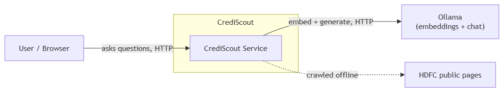
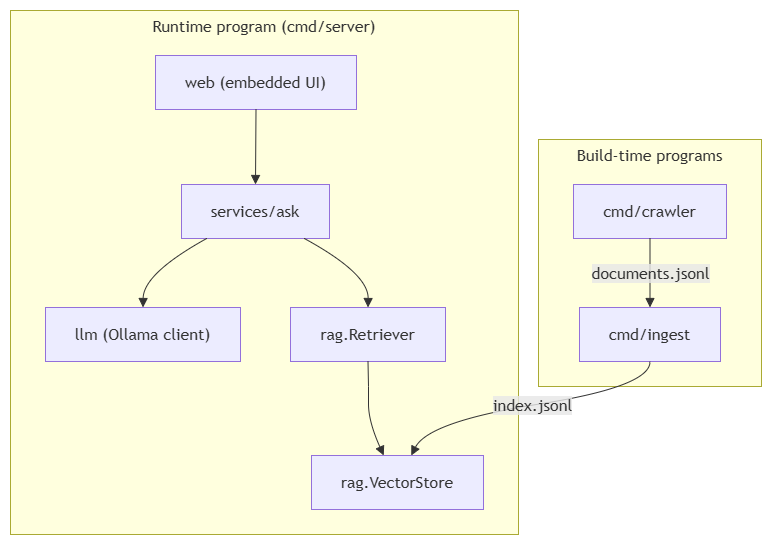
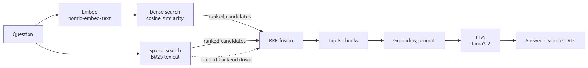

# Introduction

CrediScout is a Retrieval-Augmented Generation (RAG) assistant that answers
questions about **HDFC credit cards**, grounded strictly in content crawled from
HDFC's public pages. Ask a natural-language question, get a concise answer **plus
the source URLs** it was drawn from — no hallucinated facts, no external
knowledge.

It is built end-to-end in Go as three independent programs plus a small embedded
web UI (crawler → RAG index → retrieval → LLM → UI), and deploys on Kubernetes —
locally on **kind** or on **GKE** via the same kustomize base.

| Stage | Program | Role |
|-------|---------|------|
| **Crawl** | `cmd/crawler` | Concurrently fetches HDFC credit-card pages → `data/documents.jsonl` |
| **Index** | `cmd/ingest` | Chunks + embeds the corpus into a vector index → `data/index.jsonl` |
| **Serve** | `cmd/server` | Loads the index, serves retrieval + LLM answers over HTTP, hosts the UI |

Key properties:

- **Grounded answers** — the LLM is instructed to answer *only* from retrieved
  HDFC context; if nothing relevant is found it says so instead of guessing.
- **Concurrent & fast** — the crawler uses a worker pool; the server is
  stateless and read-only at request time, so it scales horizontally.
- **Fully offline / local** — embeddings and chat both run on a local
  [Ollama](https://ollama.com) instance. No cloud APIs, no API keys.
- **Interface-driven** — `Store`, `Embedder`, `LLM`, and `Retriever` are Go
  interfaces, so the LLM/embedding backend can be swapped (e.g. for a managed
  cloud endpoint) via configuration, and tests run with fakes — no network.

## Architecture

This section introduces the architecture of CrediScout for working purposes.

## Context

This chapter provides an overview of the system context — who uses CrediScout
and the external systems it depends on.



## Building Block

This chapter shows the static decomposition of the system. CrediScout is treated
as a separate system; Ollama and the HDFC pages are shown as external
dependencies.



The layering keeps transport concerns out of business logic:

```
main (DI) → server → endpoint binder → REST handler → ask service → rag.Retriever + llm.LLM
```

The `ask` service imports neither Gin nor Ollama types directly — it depends on
the `Retriever` and `LLM` interfaces, which is what makes it unit-testable
without a network.

## Runtime

This chapter describes the key runtime scenario: answering a question. The
offline stages (crawl, index) build the corpus; the online stage serves queries.

**Request flow** (`POST /api/ask`):

1. The question is embedded (`nomic-embed-text`, 768-dim).
2. **Hybrid retrieval** runs two rankers in parallel over the corpus:
   - **Dense** — brute-force **cosine similarity** on the embeddings (captures
     semantic intent).
   - **Sparse** — an in-memory **BM25** lexical index (captures exact / branded
     terms like *"Lifetime Free"* that embeddings tend to dilute across a chunk).

   Each ranker retrieves a *wide* candidate pool; the two lists are merged with
   **Reciprocal Rank Fusion (RRF)** and trimmed to top-K. Fusing by rank means
   the incomparable score scales (cosine vs BM25) combine without tuning. If the
   embedding backend is unavailable, retrieval **degrades gracefully to
   lexical-only** rather than failing the request.
3. The retrieved chunks + question are composed into a grounding prompt and sent
   to the chat model (`llama3.2`).
4. The answer is returned with **deduplicated source URLs**. If retrieval finds
   nothing relevant, the service short-circuits with an "I don't have any
   information…" response — the LLM is never asked to invent an answer.

The hybrid retrieval path (step 2) in detail:



> If the embedding backend is unavailable, the dense leg is skipped still RRF
> fuses the lexical results alone, so the request still succeeds.


## Deployment

This chapter describes the mapping of the building blocks to the infrastructure.
Deployment uses a **kustomize base + overlays** layout with a `local` (kind) and
a `gke` (Google Kubernetes Engine) target. See [Deployment (Kubernetes)](#deployment-kubernetes)
below for the full walkthrough.

# Prerequisites

| Tool | Version used | Purpose |
|------|--------------|---------|
| **Go** | 1.26+ | Build & run the three programs |
| **Ollama** | latest | Local embeddings + chat (runs on host) |
| **Docker** | 24+ | Build images |
| **kind** | 0.33+ | Local Kubernetes cluster (local deployment only) |
| **kubectl** | 1.30+ | Apply manifests (deployment only) |
| **gcloud** | latest | GKE cluster + Artifact Registry (GKE deployment only) |

Pull the two Ollama models once:

```powershell
ollama pull nomic-embed-text
ollama pull llama3.2
```

Ensure Ollama is running and reachable at `http://localhost:11434`.

# Quick start

Steps to run the full pipeline locally:

```powershell
# 1. Crawl HDFC pages -> data/documents.jsonl  (please note: max 200 pages by default)
go run ./cmd/crawler

# 2. Build the vector index -> data/index.jsonl  (please note: needs Ollama running in local)
go run ./cmd/ingest

# 3. Start the server (please note: loads the index, run simple UI and API on localhost port 8080)
go run ./cmd/server
```

Then open **http://localhost:8080** and ask a question, or call the API
directly (see below).

> Steps 1 and 2 are **one-time build steps**. Once `data/index.jsonl` exists,
> you only need step 3 to run the app. The data and index live under `data/`

# API reference

### `GET /healthz`
Liveness/readiness probe.
```json
{ "status": "ok" }
```

### `POST /api/ask`
Ask a question against the HDFC corpus.

**Request**
```json
{
  "question": "What are the benefits of the Regalia card?",
  "top_k": 5
}
```
`question` is required; `top_k` is optional (defaults to the server's `TOP_K`).

**Response** — `200 OK`
```json
{
  "answer": "…",
  "sources": [ { "url": "…", "title": "…", "score": 0.71 } ]
}
```

| Status | Meaning |
|--------|---------|
| `200` | Answer generated (or a grounded "no information" reply) |
| `400` | Missing/invalid `question` |
| `500` | Retrieval or LLM failure |

### Static UI
`GET /` (plus `/app.js`, `/style.css`) serves the embedded chat UI.

# Unit Testing

```powershell
# Run all unit tests with coverage
go test -cover ./...
```

Tests use **fakes** for the `Store`, `Embedder`, and `LLM` interfaces, so the
crawler, RAG pipeline, retriever, and `ask` service are all covered **without
any network or Ollama dependency**. Covered packages include
`internal/crawler`, `internal/rag`, and `internal/services/ask`.

# Performance & Load Testing

Load is generated with [k6](https://k6.io) via [scripts/load-test.js](scripts/load-test.js),
which exposes two scenarios selected with the `SCENARIO` env var:

```powershell
# Raw server headroom — request handling only, no LLM (does not need Ollama)
k6 run -e SCENARIO=healthz scripts/load-test.js

# Full RAG path — embed -> hybrid retrieve -> LLM (needs Ollama + a built index)
k6 run -e SCENARIO=ask scripts/load-test.js
```

### Results

Measured locally (Windows, local Ollama, 30s `healthz` / 60s `ask`):

| Scenario | VUs | Requests | RPS | p50 | p95 | p99 | Errors |
|----------|----:|---------:|----:|----:|----:|----:|-------:|
| `healthz` (server only) | 50 | 529,666 | **17,654 req/s** | 2.55 ms | 4.61 ms | 7.45 ms | 0.00% |
| `ask` (full RAG + LLM)  | 10 | 25       | 0.30 req/s      | 29.8 s  | 37.4 s  | —       | 0.00% |

### Interpretation

- **The Go server is the fast part.** At 50 concurrent users it sustains
  **~17.6k req/s with a p95 of 4.6 ms and zero errors** — this validates the
  "fast & concurrent" design (stateless, read-only request path, scales
  horizontally).
- **End-to-end latency is set by the model backend, not the app.** In the `ask`
  scenario the p95 (≈ 37 s) reflects local Ollama generation on **CPU** — the
  retrieval and HTTP layers contribute a negligible share. This is a clean
  separation of concerns: the application tier is effectively free, so
  answer speed is tuned entirely at the inference layer. Running Ollama on a
  **GPU**, using a smaller/quantised model, or adding **model replicas** behind
  the stateless app tier improves latency and throughput **without any
  application changes**.

> The `healthz` scenario is the meaningful measure of the service's own
> concurrency headroom; the `ask` scenario characterises the LLM backend.

# Deployment (Kubernetes)

The `deploy/` directory is a **kustomize base + overlays** layout, so the same
building blocks target two environments from one source of truth:

```
deploy/
  base/               # environment-agnostic: namespace, ConfigMap, app
                      #   Deployment (2 replicas), Service, HPA (2→6 CPU), PDB
  overlays/
    local/            # kind: local :local images, host-gateway Ollama
    gke/              # GKE: Artifact Registry images, in-cluster Ollama,
                      #   NEG + BackendConfig + Ingress (HTTP[S] LB)
```

Pick an overlay when applying — never apply `base/` directly:

| Environment | Command |
|-------------|---------|
| Local (kind) | `kubectl apply -k deploy/overlays/local` |
| GKE | `kubectl apply -k deploy/overlays/gke` |

Preview the fully-rendered manifests for either without a cluster:

```powershell
kubectl kustomize deploy/overlays/local
kubectl kustomize deploy/overlays/gke
```

The stateless app is identical in both; only the image sources, Ollama location,
and external-access wiring differ (all handled by the overlays).

## Local (kind)

The app runs in-cluster; the LLM (Ollama) runs on your **host** and is reached
via the Docker Desktop host gateway (`OLLAMA_URL=http://192.168.65.254:11434`,
set by the local overlay). The vector index is delivered to each pod by an
**initContainer** that copies it out of the `crediscout/index:local` image.

### Deploy

```powershell
# 1. Create the cluster
kind create cluster --name crediscout

# 2. Build the two local images
docker build -t crediscout/app:local .
docker build -f Dockerfile.data -t crediscout/index:local .

# 3. Load them into the kind node (no registry needed)
kind load docker-image crediscout/app:local crediscout/index:local --name crediscout

# 4. Apply the local overlay
kubectl apply -k deploy/overlays/local

# 5. Port-forward and open the UI
kubectl -n crediscout port-forward svc/crediscout 8080:80
#   Service should be acceseble at http://localhost:8080
```

> **Prerequisite:** host Ollama must be running with both models pulled, since
> the pods call out to it. Verify the host-gateway IP from inside the node with
> `docker exec crediscout-control-plane getent hosts host.docker.internal` and
> update `deploy/overlays/local/patch-ollama-url.yaml` if it differs.

### Tear down
```powershell
kind delete cluster --name crediscout
```
